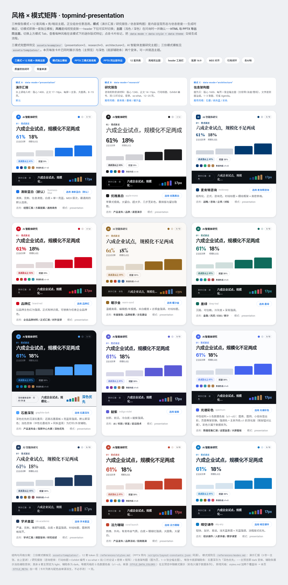

# topmind-presentation

English | [中文](./README.md)

[](https://github.com/topmindspace/topmind-presentation/releases)
[](https://www.npmjs.com/package/@topmindspace/topmind-presentation)
[](https://github.com/topmindspace/topmind-presentation/actions/workflows/ci.yml)
[](LICENSE)

An agent skill for presentations. It turns your material into a **single-file, page-turning HTML deck** and, when needed, an **editable 16:9 PPTX**. Both come from one content model, so colours, layouts and numbers match. It can also re-lay-out an existing PPTX without changing a word.

- Version: **v0.2.9**
- Agents start at `SKILL.md`; this README is for people installing and maintaining the skill
- The generated content and the skill's own docs are in Chinese

<p align="center">
  <br/>
  <sub>12 styles, each with light and dark themes · interactive version: <a href="./assets/style-gallery.html">style gallery</a></sub>
</p>

## What it does

| | |
|---|---|
| Deliverables | Single-file HTML (no external links, arrow-key paging, light/dark and style switcher) + editable PPTX (native charts you can double-click to edit) |
| Three modes | Presentation · Research report (dense, sourced) · Architecture (layers / swimlanes / flows / topology) |
| 12 styles | business-blue (default), apple-mono, mckinsey, brand-red, warm-sand, deep-teal, graphite-dark, indigo-violet, spectrum, ink-academic, coral-launch, sky-airy |
| Layouts & charts | 48 layouts in 8 families; 36 chart types, 20 exported as native PowerPoint charts |
| Illustrations | Text-and-image layouts (full, image-left/text-right, bleed, grid, compare, logo wall); layer diagrams, swimlanes, flows and topologies export as editable native shapes |
| Beautify an existing deck | The original is read-only; every word, number, image and speaker note is checked before the new deck is delivered |
| Quality gates | HTML and PPTX must each pass strict with 0 errors and 0 warnings; page-by-page HTML↔PPTX fidelity check; rendered pages are checked for fill, balance and pixel regressions |
| Page layout | Body text uses 1.5× line spacing by default (1.3× when space is short); no eyebrow or footer note by default, only a quiet page number, so the space goes to content (`showEyebrow` / `showFootnotes` / `pageNumber` switches) |
| Complex infographics | How to write composite layouts, paired charts, small multiples and image layouts, and where PPTX fidelity ends: [`references/infographics-guide.md`](./references/infographics-guide.md) (Chinese) |
| Extensible | Extension points for custom layouts, styles and charts within the rules: [`references/extending.md`](./references/extending.md) |

## Five routes

The agent first decides the route, then reads only that route's recipe (`recipes/`).

| You say / give | Route | You get |
|---|---|---|
| "Turn this research into a briefing" | Generate | A titles-only draft to confirm, then HTML (optionally PPTX) |
| "Fast mode, just make it" | Fast | No questions; HTML with sensible defaults |
| An old .pptx + "make it look better" | Beautify | A new deck in a new folder; every word, number, image and speaker note is checked against the original |
| A company template + "use these colours" | Template | Theme colours and fonts extracted; the closest built-in style is used |
| "Draw our system architecture as slides" | Architecture | A 1–8 page, diagram-first deck |

## Install

Your agent's skills folder must contain `topmind-presentation/SKILL.md`. The installer is the easiest way:

```bash
npx @topmindspace/topmind-presentation install                    # probes ./.claude, ./.agents, ./.cursor, ./.codex, then your home folder
npx @topmindspace/topmind-presentation install --to ~/.claude/skills
npx @topmindspace/topmind-presentation@latest install             # upgrade: the old version is overwritten
npx @topmindspace/topmind-presentation@0.2.7 install --force       # downgrading requires --force
npx @topmindspace/topmind-presentation install --link             # for development: symlink to the package instead of copying
```

Install rules (covered by `tests/install/test_install.js`, enforced in CI):

1. **Upgrade by default**: if the installed version is older than the package (or has no readable version), it is overwritten with no backup. Same version prints "already up to date"; `--force` reinstalls.
2. **No silent downgrade**: if the installed version is newer than the package, the installer stops with an error. Only `--force` downgrades.
3. **Same-name folders are replaced automatically**: with the default (copy) mode, a target folder that is a previous install of this skill (`SKILL.md` name is `topmind-presentation`, or a symlink to one) is replaced without `--force`. An unrelated folder with the same name (no SKILL.md, or a different name) needs `--force`. Symlinks are removed as links; their targets are never deleted.

Other ways to install:


```bash
# Release zip (recommended, pinned version)
unzip topmind-presentation.zip -d ~/.claude/skills/

# Track the repository
git clone --depth 1 https://github.com/topmindspace/topmind-presentation.git ~/.claude/skills/topmind-presentation

# npm (about 1.1 MB, published with provenance), then copy it into the skills folder
npm i @topmindspace/topmind-presentation
cp -r "$(npx topmind-presentation path)" ~/.claude/skills/topmind-presentation
```

Then run the self-check:

```bash
cd ~/.claude/skills/topmind-presentation
npm install                 # only needed for PPTX export (pptxgenjs)
python3 scripts/doctor.py   # or: npx topmind-presentation doctor; add --full to render a sample
```

Requirements: HTML generation and all validators use only the Python 3.8+ standard library. PPTX needs Node 18+ and pptxgenjs; the beautify route needs python-pptx; comparison images and pixel regression need LibreOffice and poppler. `doctor` tells you exactly what is missing.

## Try it by hand

```bash
# One command: render → strict on both sides → density → fidelity
npx topmind-presentation build assets/examples/2026-09-09-research-mckinsey.model.json --out out --fidelity

python3 scripts/render_from_model.py assets/examples/2026-09-09-presentation-business-blue.model.json \
  --template presentation --out demo.html
python3 scripts/validate_report.py demo.html --strict
node scripts/build_pptx.js demo.pptx --model=assets/examples/2026-09-09-presentation-business-blue.model.json
python3 scripts/validate_pptx.py demo.pptx --strict --model=assets/examples/2026-09-09-presentation-business-blue.model.json

# Beautify an existing PPTX (the original is read-only)
python3 scripts/beautify.py old.pptx --out beautified --style business-blue --compare
```

## Layout

```
SKILL.md            agent entry: route table, gates, rules (≤300 lines)
recipes/            one recipe per route; only the chosen one is read
references/         in-depth specs, read only when needed
assets/templates/   HTML templates for the three modes (engine, styles, runtime inlined)
assets/examples/    model.json for three golden samples (npm ships models only; HTML renders in one command)
assets/icons/       48 original line icons
scripts/            render, export, validate, beautify, doctor, regression
tests/              beautify samples, layout goldens, pixel baselines
evals/  docs/       eval set and landing page (not packaged)
```

## Maintenance

```bash
bash scripts/ci_skill_gates.sh --with-pptx   # every gate CI runs
python3 scripts/pixel_regression.py          # pixel regression; add --update after intentional layout changes
bash scripts/smoke_pack.sh                   # pack → install → doctor --full
python3 scripts/sync_runtime.py              # required after editing layout-constants.json / model-schema.json
npm run capture-themes                       # re-capture the style overview above (needs playwright)
```

Upgrading to 0.2.8: [`docs/MIGRATION-0.2.8.md`](./docs/MIGRATION-0.2.8.md). Release notes: [`CHANGELOG.md`](./CHANGELOG.md).

## License

MIT © TopMindspace — [LICENSE](./LICENSE)
